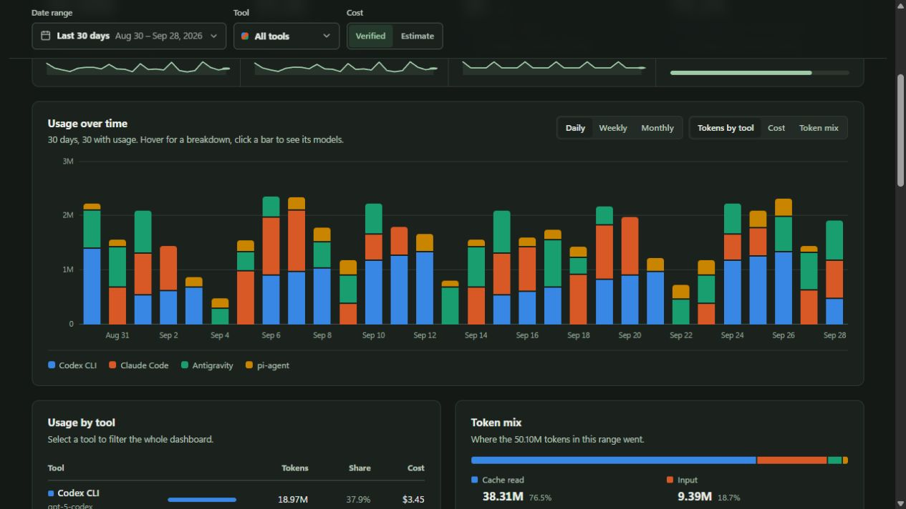
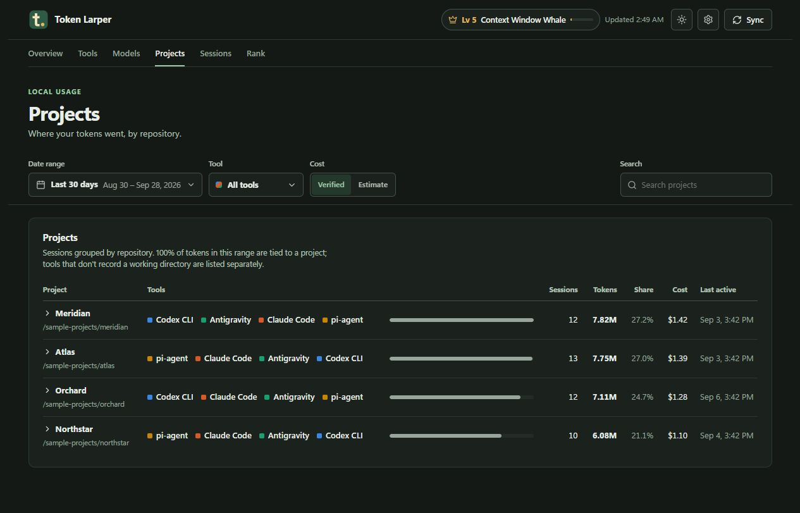
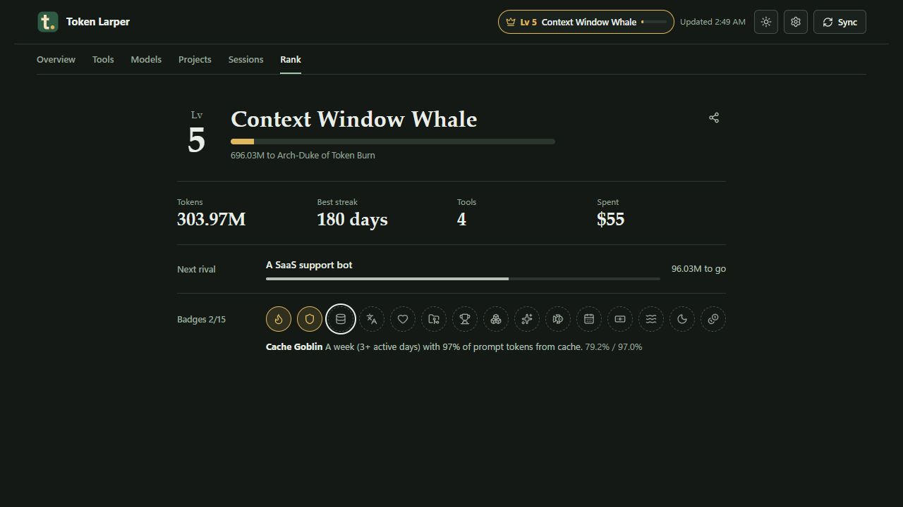
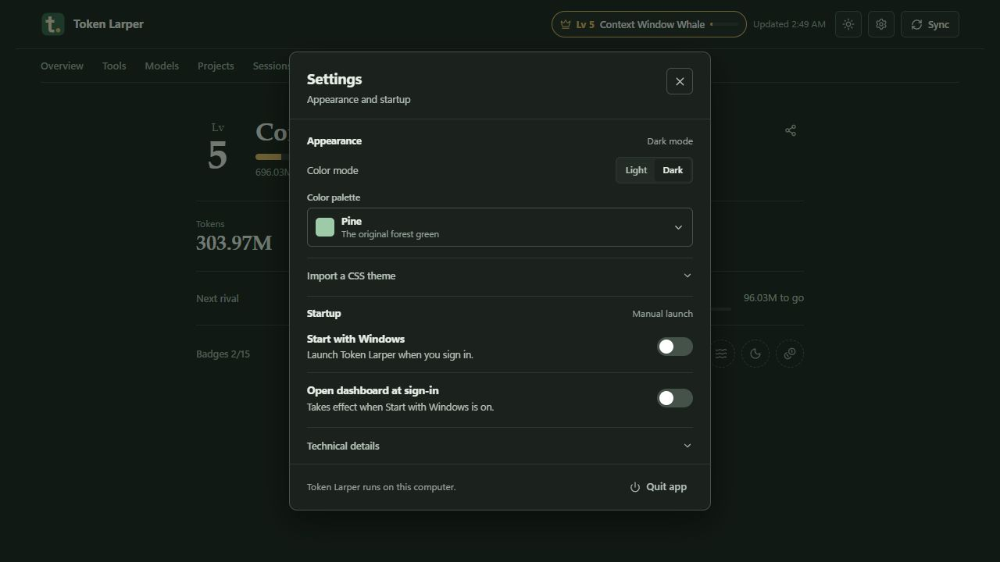

<p align="center">
  <picture>
    <source media="(prefers-color-scheme: dark)" srcset="docs/media/logo-dark.svg">
    
  </picture>
</p>

<h1 align="center">Token Larper</h1>

<p align="center">
  See what your AI coding agents cost you, and how much of your plan is left, in one local dashboard.
</p>

<p align="center">
  <a href="https://www.npmjs.com/package/token-larper"></a>
  
  <a href="LICENSE"></a>
</p>

<p align="center">
  <a href="#quick-start">Quick start</a> ·
  <a href="#a-quick-tour">A quick tour</a> ·
  <a href="#limits">Limits</a> ·
  <a href="#live-mode">Live mode</a> ·
  <a href="#supported-agents">Supported agents</a> ·
  <a href="#privacy-and-network-requests">Privacy</a> ·
  <a href="#uninstalling">Uninstall</a> ·
  <a href="#troubleshooting--faq">FAQ</a>
</p>

<video src="https://github.com/user-attachments/assets/104c8036-694e-474b-81e1-d33576f2cc30" controls playsinline poster="https://raw.githubusercontent.com/YarooqH/token-larper/main/docs/media/overview.jpg" width="820">
  <a href="docs/media/walkthrough.mp4">Watch the 20-second walkthrough</a>
</video>

Token Larper reads the session logs that Claude Code, Codex, Antigravity, GitHub Copilot CLI, OpenCode, and 13 other coding agents already write to your disk, and turns them into a dashboard at `localhost:4269`. Your prompts and usage stay on your machine. It runs on Windows, macOS, and Linux, and on Windows it also sits in the system tray.

It's built on top of [`ccusage`](https://github.com/ccusage/ccusage), which does the log parsing, token counting, and pricing. Token Larper adds the dashboard, subscription limits, Live mode, model speed, project grouping, the tray icon, and the Hall of Larp.

## Quick start

Token Larper runs on [Bun](https://bun.sh) 1.1 or later. Install it once:

```bash
# macOS & Linux
curl -fsSL https://bun.sh/install | bash
```

```powershell
# Windows
powershell -c "irm bun.sh/install.ps1 | iex"
```

Restart your terminal, then run:

```bash
bunx token-larper
```

It starts in the background and opens the dashboard. Stop it with `bunx token-larper stop`.

---

## A quick tour

The video above and the screens below use sample data. No local sessions or project names are included.

| Usage breakdown | Projects |
| --- | --- |
|  |  |

| Hall of Larp | Settings |
| --- | --- |
|  |  |

The dashboard has seven tabs, plus Live mode and Settings:

| Tab | What it shows |
| --- | --- |
| **Overview** | Tokens and cost across every tool for the date range, the token mix, and a Quota strip with what's left on your paid plans. |
| **Limits** | Every subscription's rolling windows, how much of each is used, and when it resets. See [Limits](#limits). |
| **Tools** | Each tool's tokens, cost, speed, and tokens per minute, with speed over time. |
| **Models** | The same per model, plus the price list behind cost estimates. |
| **Projects** | Sessions grouped by repository, so work in any folder of a repo counts toward it. |
| **Sessions** | Every session with its tool, model, project, tokens, cost, and speed. |
| **Stats** | The Hall of Larp: day streak, lifetime rank, rivals, records, and badges. |

---

## Features

* **18 agents, one total**: Every supported agent is detected automatically and counted together, with filters per tool, model, session, and project. No API keys and no proxy to set up.
* **Subscription limits**: The **Limits** tab shows what's left of your Claude, Codex, Copilot, Antigravity, and OpenCode Go plans: each rolling window, how much is used, and when it resets. More than one signed-in account per tool is shown side by side. See [Limits](#limits).
* **Subscription-aware costs**: Verified API costs are kept apart from the estimated **"LARP Value"**, the API price of tokens you used through a flat-rate plan like Claude Pro/Max, Copilot, or Antigravity. Estimates use [OpenRouter's](https://openrouter.ai/models) current list prices, so new models are priced without waiting for an update.
* **Live mode**: Press **Live** in the top bar and the dashboard becomes one screen that updates every second: tokens per minute with a rolling trace, every response on a tape as it lands, tokens by tool and by model, output speed per response, and your active sessions with their context size. See [Live mode](#live-mode).
* **Model speed**: Approximate output tokens per second for each tool and model, and tokens per minute while a tool is working, read from the session files of Claude Code, Codex, OpenCode, Pi, Antigravity, Gemini CLI, and Copilot CLI. See [Speed and tokens per minute](#speed-and-tokens-per-minute).
* **Hall of Larp**: A day streak with streak freezes and a daily goal, an 11-tier lifetime rank with rivals, 14 badges, and a 1200×630 share card. See [Hall of Larp](#hall-of-larp).
* **History that doesn't shrink**: When a tool prunes, moves, or compresses its old logs, the days ccusage already reported are kept, so lifetime totals and streaks don't drop.
* **Private by default**: Your usage, prompts, and project names never leave your machine. **Screenshot mode** replaces project names and folders with Project A, Project B, and so on, for screen shares. See [Privacy and network requests](#privacy-and-network-requests) for every request the app makes.
* **Six styles, your colors**: Grove, Terminal, Paper, Brutal, Soft, and Mono each change fonts, corners, spacing, borders, and shadows. Pick a base color and an accent from presets or any custom color, or import a tweakcn/shadcn CSS theme.
* **Cross-platform**: The engine, scanners, and dashboard behave the same on Windows, macOS (Apple Silicon and Intel), and Linux. The tray icon is Windows-only.
* **Lightweight install**: About 5 MB with its dependencies, on top of Bun. No Electron, no database, and the dashboard ships prebuilt.

---

## Requirements

* **Windows 10 or 11, macOS 12 or later, or Linux** (x64 or ARM64).
* **[Bun](https://bun.sh) 1.1 or later.** Check with `bun --version`; install it with the commands in [Quick start](#quick-start). Restart your terminal afterwards so `bun` is on your `PATH`.
* **Windows PowerShell 5.1** (Windows only, already installed), for the tray icon. If scripts are blocked, run `Set-ExecutionPolicy -Scope CurrentUser -ExecutionPolicy RemoteSigned`.
* **At least one supported agent** that you've used, so there are session logs to read.

---

## Running Token Larper

### With `bunx` (recommended)

```bash
bunx token-larper               # start in the background and open the dashboard
bunx token-larper stop          # stop it
bunx token-larper --foreground  # run in this terminal with logs (Ctrl+C stops it)
bunx token-larper --no-open     # start without opening the browser
bunx token-larper --help        # all options
```

It keeps running after you close the terminal and writes its output to `server.log` in the [data folder](#data-folder). Running it again while it's already running just opens the dashboard; a newer version takes over from an older one on the same port.

### From source

```bash
git clone https://github.com/YarooqH/token-larper.git
cd token-larper
bun install
bun start          # run in the terminal
bun run dev        # restart on file changes
bun run stop       # stop it
```

On Windows, `bun run tray` (or double-clicking `Start-TokenLarper.vbs`) starts it with no console window, straight into the tray. On macOS and Linux, `nohup bun start > /dev/null 2>&1 &` runs it in the background.

### The Windows tray icon

* The **`t.`** icon appears in the notification area. Hover it for today's tokens and cost.
* Left-click it for a popup with today, this week, all time, and your streak, and an **Open dashboard** button.
* Right-click it to open the dashboard, **Sync Harnesses Now**, turn on **Start on Windows Boot** and **Auto-Open Browser on Boot**, or **Quit Token Larper**.

Open the dashboard yourself at **[http://localhost:4269](http://localhost:4269)**.

---

## Limits

The **Limits** tab shows the plans you're signed in to and how much of each is left. The **Quota** strip on the Overview and Tools tabs shows the same for paid plans in one compact list, and only a window that's running low gets a color.

| Tool | What it shows | Where it comes from |
| --- | --- | --- |
| **Claude Code** | The 5-hour and weekly windows, per-model weekly limits, and extra usage. | Anthropic's usage endpoint, with the sign-in Claude Code saved. If that can't be read, the current 5-hour session rebuilt from your local logs, with its reset time but no percentage. |
| **Codex** | The 5-hour and weekly windows, code review quota, and credits. | ChatGPT's usage endpoint, with the sign-in Codex saved. If that fails, the latest rate-limit reading in your Codex session logs. |
| **GitHub Copilot** | Premium requests, chat, and completions for the month. | GitHub's Copilot endpoint, with the token GitHub Copilot saved. |
| **Antigravity** | Each model's quota and AI credits. | Google's Cloud Code endpoint, with the sign-in Antigravity saved, falling back to the app's local state. |
| **OpenCode Go** | The $12 5-hour, $30 weekly, and $60 monthly caps. | Worked out locally from your OpenCode and Pi sessions at OpenCode Go's list rates. Nothing is requested. |

Token Larper only reads the sign-ins these tools have already saved. It never refreshes them, writes them, or sends them anywhere but the tool's own vendor. If you're signed in with more than one account (another `~/.claude*` or `~/.codex*` folder, or a second Antigravity profile), each account gets its own card.

Free plans are hidden by default; **Show free** on the Limits tab brings them back. Readings refresh about once a minute while a tab that shows limits is open, and **Sync** refreshes them now. A tool whose lookup fails keeps its last reading, marked stale, for up to 15 minutes; after that it shows why the lookup failed instead of old numbers. Offline mode skips the live lookups and keeps the local fallbacks.

The vendor endpoints aren't public APIs, so a tool can stop reporting if its vendor changes one. The rest of the dashboard doesn't depend on them.

---

## Live mode

Press **Live** in the top bar (or open `http://localhost:4269/#live`) to swap the dashboard for a single live screen. Press it again, or Esc, to go back. The full-screen button next to the time span fills the monitor.

* **Tokens per minute**: the last 60 seconds, with the 5-minute average and how much of the prompt came from cache. The trace under it is the same rolling minute over the last 15 or 60 minutes, stacked by tool; hover it to read each tool at that moment.
* **The tape**: every response as a tick at the moment its last token landed. Taller ticks wrote more output; hover one for its model, output, and speed.
* **Output, Speed, Requests, Burn rate**: output tokens per minute, the median response's tok/s over 5 minutes, requests per minute, and the last 5 minutes' pace in dollars per hour at API list prices.
* **By tool** and **By model**: tokens in the time span, what each is burning right now, its speed, and cost.
* **Output speed**: each response as a dot, with the 5-minute median as a line.
* **Sessions**: sessions that answered in the last 15 minutes, with tokens per minute now, context size (the latest prompt, cache included), speed, and cost over the last hour. **Responses** lists the newest 14.

Live mode follows the session files of Claude Code, Codex, Pi, Gemini CLI, and Copilot CLI (with OpenTelemetry file export on) as they are written, reading only what was added since its last read, about once a second. Antigravity keeps each conversation in a SQLite database, so Live mode reads the steps added since its last read instead. It stops 30 seconds after you leave Live mode.

### What Live mode can't see

* **Claude chats.** Chats on claude.ai and in the Claude app aren't saved on your computer, so they never appear. Only the Code tab in the Claude app counts, since it runs Claude Code.
* **Some tools.** OpenCode and the tools only ccusage reads (Amp, Droid, Goose, and the rest) aren't followed live. They show up in the dashboard after a sync.
* **Responses in progress.** A response counts when its last token is logged, so a long one lands all at once and tokens per minute comes in bursts.
* **More than an hour back.** Only the last hour is kept, read again from the session files when Token Larper starts.
* **What you actually pay.** Costs and the burn rate use API list prices, even on a subscription. A model with no known price adds $0.
* **Pure generation speed.** Speed includes the wait for the first token. Antigravity records times to the second, so its short steps read rough. Antigravity's thinking tokens count toward speed but, as in ccusage's totals, not toward token counts.

Tokens include cache reads, the same as everywhere else in the dashboard, so they run far above what the model writes. The same list is on the Live screen: press **Limitations** in its header.

---

## Speed and tokens per minute

The **Tools**, **Models**, and **Sessions** tabs show an approximate **Speed** column: output tokens per second, timed from when a request is sent to when its last token arrives. ccusage only reports totals, so Token Larper reads the timing from each tool's own session files. Hover a value for the median, p90, and number of responses behind it; a value from fewer than 10 responses is dimmed. On the Tools and Models tabs, Speed follows the date range; on the Sessions tab, each session shows its speed over its whole life.

**Speed over time** on the Tools and Models tabs draws one line per tool or per model, per day, week, or month, so you can compare them as models and versions change. Switch between **Average** (all output tokens over all response time, the same as the Speed column) and **Median** (the middle response's speed), or to **Table** for the exact numbers. The Models chart shows the 7 models with the most responses in the range; pick a tool to compare only its models.

Speed includes waiting for the first token, and that wait grows with the size of the context. A request with a 500K-token context can spend most of its time before any output appears, so Speed reads lower than a model's own generation speed and lower than providers' published figures. Treat it as how fast responses reach you, not a benchmark.

| Tool | Where the timing comes from |
| --- | --- |
| OpenCode, Pi, Antigravity | The tool records when each request was sent and finished. OpenCode also records when the first output arrived, so its hover text adds the typical wait for it, and time spent running tools between model calls is left out. |
| Claude Code, Codex, Gemini CLI | Inferred from the log line before each response (the prompt or a tool result) and the response's last line. |
| Copilot CLI | Per request only with OpenTelemetry file export on (`COPILOT_OTEL_ENABLED=true`, `COPILOT_OTEL_EXPORTER_TYPE=file`). Without it, Copilot gets Tokens/min but no Speed. |

Responses under 20 output tokens are left out of Speed, since they are almost all wait. **Tokens/min** on the Tools tab divides all of a tool's tokens, cache reads included, by the time it was working; gaps of more than 2 minutes between responses don't count. Other tools show a dash.

The first read of the session files runs in the background and can take a few seconds per gigabyte. Results are saved per file in `throughput-cache.json` in the data folder, so later reads only open files that changed.

---

## Estimated prices

When ccusage has no price for a model (a brand-new one, or usage through a flat-rate subscription), Token Larper estimates the cost from list prices. It downloads OpenRouter's public model price list once a day, keeps it in the data folder as `openrouter-pricing.json`, and prices any model on that list from it. Claude models it doesn't list use Anthropic's rates, built into the app. A model with neither has no price and is left out of estimates; nothing is guessed from its name. If the download fails, the last saved list is used.

Switch **Cost** to **Estimate** to see the prices. The **Models** tab then adds a **Model prices** section with the price per 1M tokens (input, output, cache write, cache read) of every model you've used, which OpenRouter listing each one matched, where the prices come from, and when the list was last downloaded. The cost card on the Overview links to it with **How this is estimated**. In **Verified** mode there are no prices to show, because verified costs never use them.

Estimates do not include OpenRouter's long-context surcharges, and a model name that OpenRouter spells differently may go unpriced. Verified costs from ccusage are never changed.

---

## Hall of Larp

The **Stats** tab is lifetime only; the date and tool filters don't apply to it. Hide it under **Settings → General → Show stats**.

* **Day streak**: The tab opens on your streak and the last seven days, and the same streak sits in the header and the tray popup. Any usage keeps the streak going; the flame lights once today reaches 500K tokens.
* **Streak freezes**: Every 500M lifetime tokens earns a freeze, up to 5 held. A freeze covers one missed day, so a short gap keeps the streak without adding a day to it. Freezes only cover a gap they were earned before, and a gap longer than the freezes you hold still breaks the streak (you keep the freezes).
* **11 tiers**: From *Newcomer* (0 tokens) to *Legend* (100B tokens), shown as one rank row with your progress to the next tier.
* **Rivals**: Made-up opponents at lifetime-token milestones, from *A curious intern* up.
* **14 badges**: For things like late-night sessions, a $100 day, or using 5 different agents.
* **Share card**: A 1200×630 PNG of your rank and stats. Project names and paths are never included.

---

## Settings

Press the gear in the top bar, or the `,` key, to open Settings as a page of its own. **Dashboard** or Esc goes back to where you were. There's a search box, and each section has its own address (`#settings/privacy`) you can link to.

* **Appearance**: Light, dark, or system mode; the style; base and accent colors; and importing a CSS theme.
* **General**: Show or hide the Stats tab, **Start with Windows**, and **Open dashboard at sign-in**.
* **Privacy**: **Screenshot mode**, **Offline mode**, the automatic update check, and when each network request last ran.
* **About**: The version, **Check for updates**, and technical details such as the dashboard address.

---

## Privacy and network requests

Token Larper never sends your prompts, token counts, costs, or project names anywhere. It has no telemetry. These are the requests it does make:

| Request | When | What's sent | Turn it off |
| --- | --- | --- | --- |
| **Update check** to `registry.npmjs.org` | When the dashboard opens | Only the package name | **Settings → Privacy**, or Offline mode |
| **Price list** from `openrouter.ai` | Once a day | Nothing but the request | Offline mode |
| **Plan quotas** from Anthropic, ChatGPT, GitHub, and Google | At startup, then about once a minute while a tab that shows limits is open | Your saved sign-in for that tool, to that tool's own vendor | Offline mode |

**Offline mode** in **Settings → Privacy** (or starting with `TOKEN_LARPER_OFFLINE=1`) stops all three. Cost estimates then use the saved price list, and the Limits tab shows only what's on your machine: the Claude 5-hour session from your logs, Codex's last reading from its session logs, Antigravity's local state, and OpenCode Go. A tool that needs a live lookup says Offline mode is on.

**Screenshot mode** in the same place replaces project names and folders with Project A, Project B, and so on, everywhere in the dashboard, for screenshots and screen shares.

---

## Supported agents

Token Larper uses `ccusage` together with its own scanners to find and read session history from 18 coding agents:

| Agent | Vendor | Folder it looks for |
| :--- | :--- | :--- |
| **Claude Code** | Anthropic | `~/.claude/` and `~/.claude.json` |
| **Codex CLI** | OpenAI | `~/.codex/` |
| **Antigravity** | Google DeepMind | `~/.gemini/antigravity/` |
| **GitHub Copilot CLI** | GitHub | `~/.copilot/` (or `COPILOT_HOME`) |
| **Gemini CLI** | Google | `~/.gemini/` |
| **OpenCode** | SST / OpenCode | `~/.local/share/opencode/`, `~/.opencode/`, `%LOCALAPPDATA%\opencode` |
| **pi-agent** | Pi | `~/.pi/` |
| **Amp** | Sourcegraph | `~/.amp/`, `%LOCALAPPDATA%\amp` |
| **Droid** | Factory | `~/.factory/`, `~/.droid/` |
| **Codebuff** | Codebuff | `~/.codebuff/`, `%APPDATA%\codebuff` |
| **Hermes Agent** | Nous Research | `~/.hermes/` |
| **Goose** | Block | `~/.config/goose/`, `%APPDATA%\Block\goose` |
| **Kilo Code** | Kilo | `~/.kilo/` |
| **Kimi CLI** | Moonshot AI | `~/.kimi/` |
| **Qwen Code** | Alibaba Cloud | `~/.qwen/` |
| **OpenClaw** | OpenClaw | `~/.openclaw/` |
| **Grok Build CLI** | xAI | `~/.grok/` |
| **ZCode** | ZCode | `~/.zcode/` |

---

## Configuration

### Port

Token Larper uses port `4269`. If another program has it, it tries the next nine ports and uses the first free one. To pick your own:

```bash
PORT=5000 bunx token-larper           # macOS & Linux
```

```powershell
$env:PORT = "5000"; bunx token-larper # Windows
```

Set `PORT` the same way when you run `stop`, so it reaches the right copy.

### Data folder

Settings and caches live outside the app folder, so updates keep them:

| OS | Folder |
| :--- | :--- |
| Windows | `%LOCALAPPDATA%\TokenLarper` |
| macOS | `~/Library/Application Support/TokenLarper` |
| Linux | `$XDG_DATA_HOME/token-larper` (default `~/.local/share/token-larper`) |

It holds `settings.json`, the theme, the saved day history (`daily-history.json`), the price list, the speed and limits caches, and `server.log`. Set `TOKEN_LARPER_DATA_DIR` to use another folder. Versions before 1.5.0 kept this data in `.cache` inside the app; it's copied over on first run.

### Environment variables

| Variable | What it does |
| --- | --- |
| `PORT` | The port to use (default `4269`). |
| `TOKEN_LARPER_DATA_DIR` | Use this folder for settings and caches. |
| `TOKEN_LARPER_OFFLINE=1` | Turn on Offline mode. The switch in Settings can't turn it off while this is set. |
| `NO_TRAY=1` | Don't start the tray icon (it only starts on Windows anyway). Useful on a headless machine. |
| `COPILOT_HOME` | Where Copilot CLI keeps its files, if not `~/.copilot`. |

### Start at sign-in (Windows)

Turn on **Start with Windows** in **Settings → General**, or **Start on Windows Boot** from the tray's right-click menu. **Open dashboard at sign-in** also opens the dashboard in your browser. This adds a `TokenLarper` entry under `HKCU\Software\Microsoft\Windows\CurrentVersion\Run` that starts the windowless launcher.

### Updates

When a new version is on npm, the dashboard shows a banner. **Update now** starts `bunx token-larper@latest` in the background; the new version replaces the running one on the same port and the dashboard reloads. You can also check from **Settings → About**, or turn automatic checks off in **Settings → Privacy**. A copy cloned from git updates with `git pull`.

---

## Uninstalling

Token Larper only reads your agents' logs, so removing it leaves your session history untouched. Do the steps in this order: the Windows startup entry points at the app folder, so turn it off before you delete anything.

### 1. Turn off startup and stop it

On Windows, if you turned on **Start with Windows**, turn it off in **Settings → General**, or right-click the tray icon and uncheck **Start on Windows Boot**. Then quit from the tray, or run:

```bash
bunx token-larper stop
```

If you already deleted the app and it still launches at login, remove the startup entry by hand:

```powershell
reg delete "HKCU\Software\Microsoft\Windows\CurrentVersion\Run" /v TokenLarper /f
```

On macOS and Linux, stopping it is enough. If you set up your own LaunchAgent or `systemd --user` unit for it, remove that too.

### 2. Delete the data folder

This holds settings, caches, the saved day history, and `server.log`. Days that your agents have since pruned from their own logs exist only here, so they're gone once you delete it.

| OS | Remove it with |
| :--- | :--- |
| Windows | `Remove-Item -Recurse -Force "$env:LOCALAPPDATA\TokenLarper"` |
| macOS | `rm -rf ~/Library/Application\ Support/TokenLarper` |
| Linux | `rm -rf "${XDG_DATA_HOME:-$HOME/.local/share}/token-larper"` |

If you set `TOKEN_LARPER_DATA_DIR`, delete that folder instead.

### 3. Remove the app

* **Ran it with `npx` or `bunx`**: Nothing was installed globally. The package sits in the npx or Bun cache, and it's fine to leave it there. To get the space back, delete npx's cache folder (`~/.npm/_npx`, or `%LOCALAPPDATA%\npm-cache\_npx` on Windows) or run `bun pm cache rm`. Both clear every cached package, not only this one; the others download again the next time you use them.
* **Installed it globally**: `npm uninstall -g token-larper` or `bun remove -g token-larper`.
* **Cloned from git**: Delete the folder. Versions before 1.5.0 kept their data in `.cache` inside it, so that goes too.

Bun stays installed. If you only installed it for Token Larper, see [Bun's uninstall steps](https://bun.sh/docs/installation#uninstall).

---

## Comparison with alternatives

| | Token Larper | LiteLLM / Portkey | Langfuse / Arize | `ccusage` CLI |
| :--- | :---: | :---: | :---: | :---: |
| **How it gets data** | Reads local session logs | HTTP reverse proxy | SDK / OTel collector | Reads local session logs |
| **Setup** | One command (`bunx token-larper`) | Custom proxy URLs per tool | Instrumenting your code | One command (`npx ccusage`) |
| **Flat-rate plans (Pro/Max, Copilot)** | ✅ Estimated LARP value | ❌ | ❌ | ✅ |
| **Remaining plan quota** | ✅ Limits tab | ❌ | ❌ | ❌ |
| **Interface** | Web dashboard + Windows tray | Web UI (cloud or Docker) | Web UI (cloud or self-hosted) | Terminal tables |
| **Agent detection** | ✅ 18 agents, automatic | ❌ Set up per tool | ❌ Code changes | ✅ 18 agents, automatic |
| **Usage stays local** | ✅ | ⚠️ Depends on deployment | ⚠️ Cloud or self-hosted DB | ✅ |
| **Streaks and share cards** | ✅ Hall of Larp | ❌ | ❌ | ❌ |

---

## Troubleshooting & FAQ

### How do I see my Claude Code token usage and spend locally?
Run `bunx token-larper`. It reads Claude Code's session files in `~/.claude/` and shows daily, weekly, and monthly tokens (input, output, cache write, cache read) with their cost, without an Anthropic API key. The **Limits** tab shows how much of your 5-hour and weekly windows is left.

### Can I track Antigravity, Claude Code, and Codex in one place?
Yes. Every supported agent on your machine is counted together, and the tool filter narrows the dashboard to one.

### Why read local logs instead of using a proxy like LiteLLM?
Many coding agents (Claude Code, GitHub Copilot CLI, Antigravity) sign in with a subscription rather than a pay-per-token API key. A proxy can't see that traffic without decrypting it. The agents already write every response to disk, so Token Larper reads that.

### `'bun' is not recognized as an internal or external command`
Bun is installed, but this terminal doesn't have `%USERPROFILE%\.bun\bin` on its `PATH`. Close and reopen the terminal, or add it for this session:
```powershell
$env:PATH += ";$env:USERPROFILE\.bun\bin"
```

### `cannot be loaded because running scripts is disabled on this system`
PowerShell's execution policy is blocking local scripts. Run:
```powershell
Set-ExecutionPolicy -Scope CurrentUser -ExecutionPolicy RemoteSigned
```

### The tray icon isn't visible
Windows may have put it in the hidden icons menu. Click the `^` arrow next to the clock, find the **`t.`** icon, and drag it onto the taskbar.

### No tokens or sessions show up
Use one of your agents for a moment, then press **Sync** in the top bar (or **Sync Harnesses Now** in the tray menu). If an agent keeps its files somewhere other than the folders in [Supported agents](#supported-agents), Token Larper won't find it.

### A tool is missing from the Limits tab
Limits only appear for tools you're signed in to with a subscription: Claude Code, Codex, GitHub Copilot, Antigravity, or OpenCode Go. Free plans are hidden until you press **Show free**. If a card says its quota couldn't be read, sign in to that tool again; Token Larper never refreshes a sign-in itself.

### The dashboard isn't on port 4269
Another program had the port, so Token Larper moved to the next free one; the address is printed when it starts and shown under **Settings → About → Technical details**. If an older copy of Token Larper is holding the port, stop it with `bunx token-larper stop`, or pick a port with `PORT`.

---

## Project layout

```
token-larper/
├── bin/cli.js                 # bunx entry: start in the background, stop, --foreground
├── Start-TokenLarper.vbs      # Windowless launcher for Windows
├── scripts/
│   ├── run-server.ps1         # Windows background watchdog and port resolver
│   ├── launch-silent.vbs      # Helper for start at sign-in
│   ├── tray-host.ps1          # DPI-aware Windows Forms tray host
│   └── build-client.ts        # Builds the dashboard into dist/
├── src/
│   ├── server.ts              # Bun HTTP server and local API
│   ├── ccusage.ts             # Reads the 18 agents through ccusage and adds our own scanners
│   ├── dailyHistory.ts        # Keeps every day ccusage has reported
│   ├── limits/                # Plan quotas for the Limits tab
│   ├── live/                  # Follows session files for Live mode
│   ├── throughput/            # Speed and tokens per minute
│   ├── pricing.ts             # OpenRouter price list and estimates
│   ├── projects.ts            # Groups sessions by repository
│   ├── settings.ts            # Offline mode and other saved settings
│   ├── updates.ts             # npm update check
│   ├── startup.ts             # Windows start at sign-in
│   ├── tray/                  # Tray lifecycle and IPC
│   └── client/                # React 19 dashboard
│       ├── App.tsx            # Layout, tabs, date ranges, and global state
│       ├── views/             # Overview, Limits, Tools, Models, Projects, Sessions, Stats, Live
│       ├── components/        # Settings page, charts, pickers, and shared pieces
│       ├── lib/               # Rank and streaks, live data, prices, screenshot mode
│       └── styles.css         # Styles and themes
└── llms.txt                   # Summary for AI assistants
```

---

## Acknowledgments

* **[`ccusage`](https://github.com/ccusage/ccusage)**: The engine behind reading session logs, counting tokens, and verified costs across coding agents.
* **[Bun](https://bun.sh)**: The runtime, bundler, and SQLite driver.
* **[Lucide](https://lucide.dev)**: The dashboard's icons.

---

## Contributing

Bug reports, fixes, and support for more agents are welcome. Read [CONTRIBUTING.md](CONTRIBUTING.md) to get set up, and please follow the [Code of Conduct](CODE_OF_CONDUCT.md). To report a security problem, see [SECURITY.md](SECURITY.md).

---

## License

MIT © Token Larper Contributors. See [LICENSE](LICENSE).
